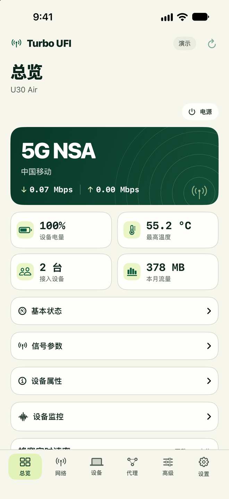
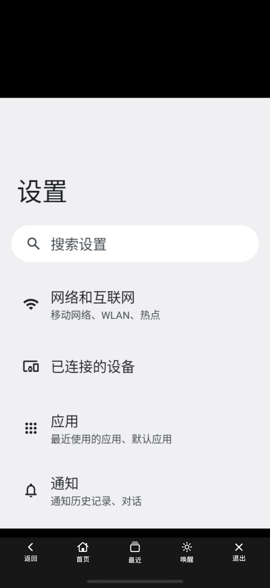
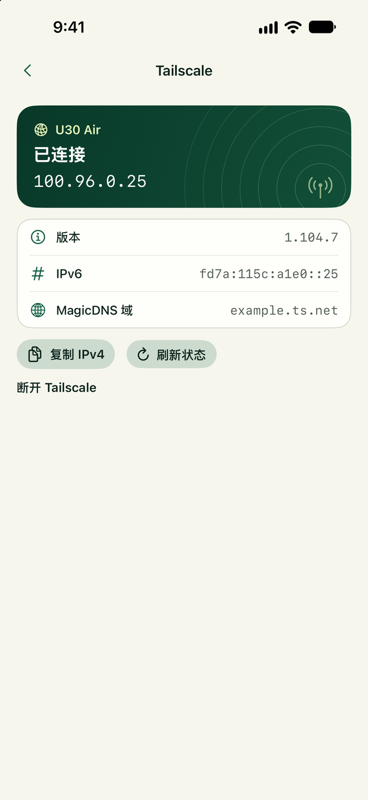
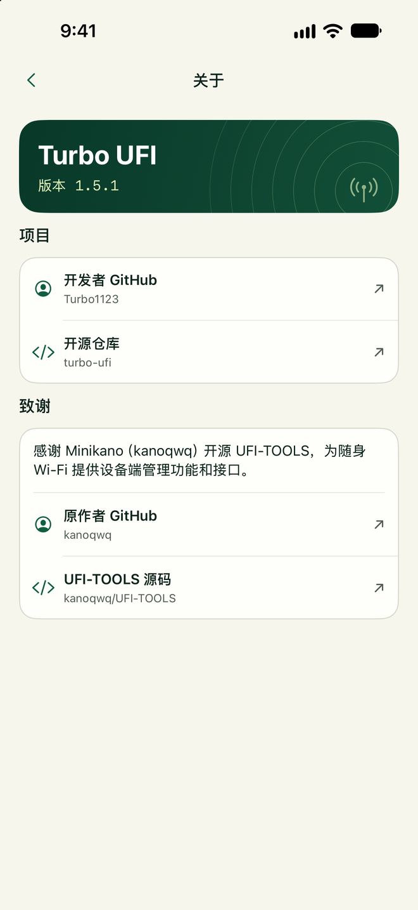
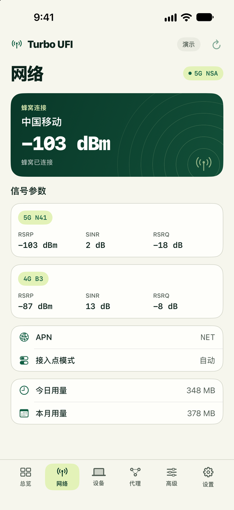
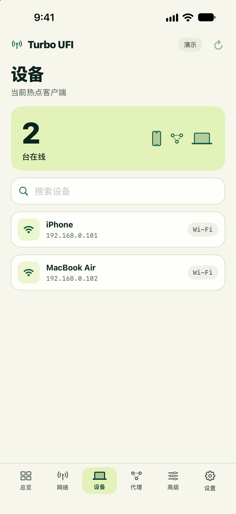
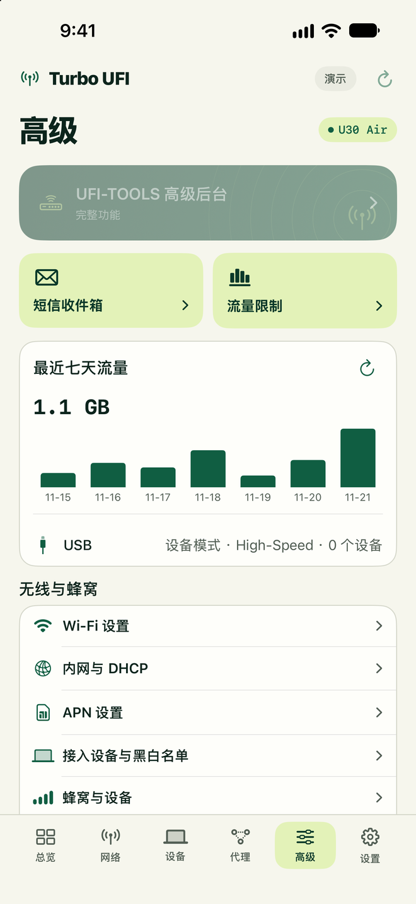
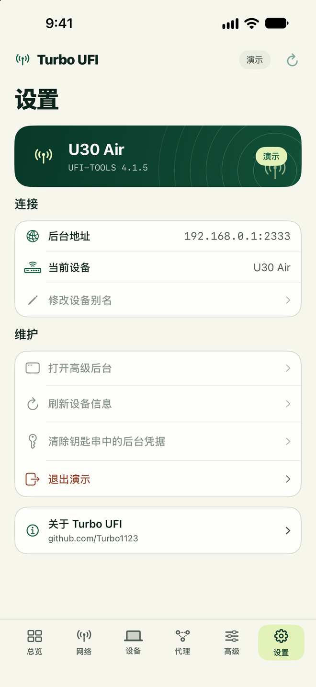

# Turbo UFI

**某兴 U30 Air 的开源 iPhone 管理端。** Turbo UFI 基于 SwiftUI 和 UFI-TOOLS，让你在 iPhone 上管理随身 Wi-Fi（Mobile Wi-Fi / MiFi），查看 4G/5G 网络和客户端，切换 Mihomo / Clash Meta 节点，控制 Tailscale，还能操作设备内置的 Android 桌面。

**Open-source iOS companion for the U30 Air and UFI-TOOLS.** Manage your mobile hotspot, inspect cellular signals and clients, switch Mihomo / Clash Meta nodes, control Tailscale, and use the hotspot’s Android desktop from your iPhone.

[下载 IPA](https://github.com/Turbo1123/turbo-ufi/releases/latest) · [从源码构建](#从源码构建) · [English quick start](#english-quick-start)

## 把 U30 Air 变成随身 Android 桌面

U30 Air 内置 Android。完成一次可信配对后，iPhone 就能通过热点直连它，在 Turbo UFI 内全屏点按、滑动和打开 Android 应用，也能使用返回、首页和最近任务。出门时不用让 Mac 做中转，就像手边多了一台随身安卓设备。桌面桥接服务运行在 U30 Air 上，iPhone 会校验配对时记录的证书指纹。

## 界面截图

<table>
  <tr>
    <th>设备总览</th>
    <th>Android 桌面</th>
    <th>Tailscale</th>
    <th>关于</th>
  </tr>
  <tr>
    <td></td>
    <td></td>
    <td></td>
    <td></td>
  </tr>
  <tr>
    <th>网络</th>
    <th>设备</th>
    <th>高级</th>
    <th>设置</th>
  </tr>
  <tr>
    <td></td>
    <td></td>
    <td></td>
    <td></td>
  </tr>
</table>

截图使用演示数据或已检查的 Android 界面。

## 主要功能

- **设备与网络** 实时网速、USB 连接、4G/5G 信号、温度、设备属性和流量。可管理 Wi-Fi、LAN / DHCP、APN 以及在线客户端。
- **代理** 设备安装猫猫 TProxy Plus 后显示代理页。可启停 Mihomo、管理开机自启、测速、搜索和切换节点。
- **Tailscale** 查看设备端 VPN 状态、IPv4、IPv6、MagicDNS 和版本。登录后的客户端可在 Turbo UFI 内连接或断开。
- **系统管理** 插件导入和导出、定时任务、短信和转发、局域网与蜂窝测速、UFI-TOOLS 更新。重启、关机等操作会要求确认。
- **凭据管理** 可把设备口令保存在 iOS 钥匙串。在 App 内打开原后台时可复用设备凭据。

## 使用与兼容性

1. 在 iPhone 上连接随身 Wi-Fi 热点，打开 Turbo UFI 并允许 iOS 的本地网络访问。
2. 输入设备的 UFI-TOOLS 地址和口令。常见默认地址为 `192.168.0.1:2333`。也可在连接页进入演示模式。
3. 如要使用 Android 桌面，需先在设备端配置 [ScreenBridge](ScreenBridge/)。Tailscale 管理需设备端安装 Tailscale，并完成登录及 Android VPN 授权。

已验证机型为 **U30 Air B14**，设备端使用 **UFI-TOOLS 完整版 4.1.5**。代理功能已验证猫猫 TProxy Plus 与 Mihomo。其他机型或固件的接口支持情况可能不同。

## 安装 IPA

[GitHub Releases](https://github.com/Turbo1123/turbo-ufi/releases/latest) 提供 **未签名 IPA** 和 SHA-256 校验文件。安装时请使用你自己的 Apple 开发者签名与描述文件，或按下面的步骤从源码构建。

## 从源码构建

- 使用支持 iOS 17 或更新版本 SDK 的 Xcode 打开 `TurboUFI.xcodeproj`。
- 选择 `TurboUFI` scheme 运行模拟器。App 无第三方 Swift 包依赖。
- 真机运行时，在 Signing & Capabilities 中选择自己的签名团队和可用的 Bundle Identifier。
- 修改 `project.yml` 后可通过 `xcodegen generate` 更新工程。

### Android 桌面桥接

`ScreenBridge/` 是配套的 Go 服务。源代码可在 Go 1.23 或更新版本用 `go test ./...` 验证。服务监听指定热点地址，只接受配置内的热点客户端。首次部署与配对通过可信 USB/ADB 完成，启动时降权到 Android shell 用户。投屏会话十分钟到期，退出页面或 App 退到后台时结束。

## English quick start

Turbo UFI requires iOS 17 or later and the full version of UFI-TOOLS on the router. Join the router’s Wi-Fi, grant Local Network access, then enter the device address and credentials. The built-in demo works without a router. After one-time setup of ScreenBridge, the Android desktop can be mirrored and controlled directly over the hotspot with no Mac in the path.

Open `TurboUFI.xcodeproj` to build with Xcode. The IPA in GitHub Releases is unsigned and requires your own signing credentials for installation.

## 致谢与许可

感谢 [Minikano（kanoqwq）](https://github.com/kanoqwq) 开源 [UFI-TOOLS](https://github.com/kanoqwq/UFI-TOOLS) 和 [设备端 API 文档](https://github.com/kanoqwq/UFI-TOOLS/blob/http-server-version/API_Doc.md)。也感谢 [猫猫 TProxy Plus](https://github.com/miofelix/maomao-tproxy-plus)、[Mihomo](https://github.com/MetaCubeX/mihomo) 和 [Tailscale](https://tailscale.com/) 项目。

Turbo UFI 由 [Turbo1123](https://github.com/Turbo1123) 维护，采用 [MIT License](LICENSE)。UFI-TOOLS 的版权声明与许可见 [Licenses/UFI-TOOLS-MIT.txt](Licenses/UFI-TOOLS-MIT.txt)。
